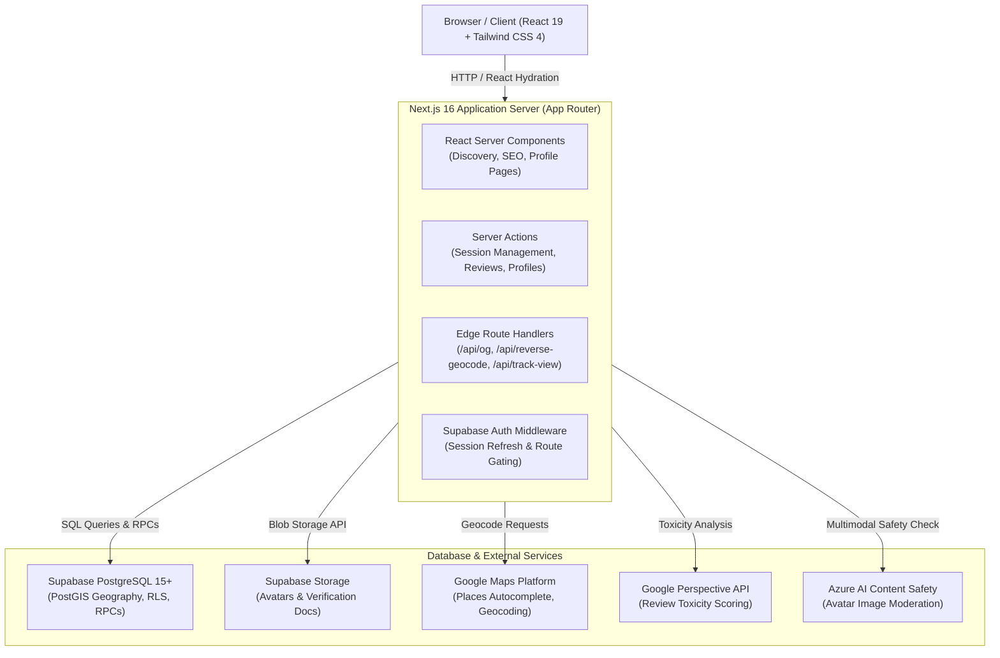

# NextTutor

A full-stack, hyperlocal tutor discovery and session management platform. NextTutor connects students with verified private tutors in their neighbourhood through geospatial search, real-time availability matching, session lifecycle tracking, and AI-assisted content moderation.

**Live Application**: [https://www.nexttutor.app](https://www.nexttutor.app)

---

## Architecture Overview

NextTutor is built on Next.js 16 App Router using React Server Components for data fetching and search indexing, combined with Client Components for interactive workflows. The backend leverages Supabase (PostgreSQL with PostGIS extensions) for relational storage, row-level security, and spatial querying, alongside Google Cloud and Azure cognitive APIs for location services and content safety.



---

## Core Features

### 1. Geospatial Discovery & Interactive Mapping
- **Spatial Radius Search**: Queries tutors within a configurable service radius using native PostgreSQL/PostGIS spatial distance queries (`ST_DWithin` on `geography(Point, 4326)`).
- **Interactive Radius Visualizer**: Google Maps integration allowing tutors to configure coverage radiuses with dynamic SVG/map circles and live radius bounding calculations.
- **Reverse-Geocoding Proxy**: Server-side proxy (`/api/reverse-geocode`) with in-memory IP rate limiting to securely resolve coordinates without exposing browser API keys or exceeding quotas.
- **Places Autocomplete**: Address lookups constrained to local regions with automatic coordinate extraction.

### 2. Dual-Role Authentication & Onboarding
- **Role-Based Workflows**: Tailored onboarding paths and interfaces for Tutors (teaching subjects, hourly/monthly fees, qualifications, service radius, weekly schedules) and Students (grade, interested subjects, parent contact details).
- **Passwordless Auth**: Supabase Auth integration supporting email magic links and OTP verification.
- **Cookie Session Management**: Server-side session validation using `@supabase/ssr` middleware with automatic token refreshes.

### 3. Session Lifecycle State Machine
- **End-to-End Tracking**: Full status workflow (`requested` &rarr; `accepted` / `declined` &rarr; `active` &rarr; `completed` / `cancelled`).
- **Server Action Mutations**: Transactional status transitions executed via Next.js Server Actions with optimistic UI updates and toast notifications.
- **Role-Gated Dashboards**: Dedicated metrics for upcoming sessions, pending requests, active students, and monthly earnings.

### 4. Trust & Multi-Tier Content Moderation
- **Dual-Stage Avatar Moderation**: User photos upload to an isolated `pending/` storage path, undergo automated multi-category inspection via Azure AI Content Safety (hate, self-harm, sexual, violence), and are promoted to public storage only upon passing verification.
- **AI Toxicity Filtering**: User reviews are evaluated against Google Perspective API before insertion, catching abusive text with graceful fail-open fallback resilience.
- **ID Verification Workflow**: Government identity document uploads for tutors with manual admin verification statuses (`pending`, `verified`, `rejected`).

### 5. Profile Analytics & Dynamic Open Graph Cards
- **View Tracking with Deduplication**: Intersection-observer client tracking (`ViewTracker`) that logs distinct profile visits via beacon API.
- **Interactive Metrics**: Tutor analytics dashboard visualizing view trends and engagement graphs using Recharts.
- **Edge OG Generation**: Dynamic Open Graph social preview cards generated at the edge via `@vercel/og` (`/api/og/tutor/[slug]`) with cache headers (`s-maxage`, `stale-while-revalidate`).

---

## Tech Stack

| Domain | Technology | Description |
|---|---|---|
| **Framework** | Next.js 16 (App Router) | React Server Components, Server Actions, Edge Route Handlers |
| **Language** | TypeScript 5 | Strict type-safety across database models, APIs, and UI |
| **UI & Styling** | React 19, Tailwind CSS 4 | Custom design system, CSS variables, `@boxicons/react` SVG icons |
| **Database** | Supabase (PostgreSQL 15+) | Row-Level Security (RLS), PostGIS geospatial extensions, SQL RPCs |
| **Storage** | Supabase Storage | Isolated buckets for user avatars and verification documents |
| **Authentication** | Supabase Auth | Passwordless magic link & OTP with `@supabase/ssr` session middleware |
| **Geospatial & Maps** | Google Maps Platform | Maps JavaScript API, Places Autocomplete, Geocoding API |
| **Content Safety** | Azure AI Content Safety | Automated image content moderation for avatar uploads |
| **Toxicity Filter** | Google Perspective API | Real-time review comment toxicity analysis |
| **Data Visualization** | Recharts 3 | Responsive analytics charts and activity graphs |
| **Testing** | Vitest 4, React Testing Library | Fast unit and integration tests with jsdom environment |
| **Continuous Integration** | GitHub Actions | Automated linting, test suite execution, and build verification |
| **Continuous Deployment**| Vercel | Production deployment, edge middleware routing, and Web Analytics |

---

## Project Structure

```
NextTutor/
├── .github/
│   └── workflows/
│       └── ci.yml                 # GitHub Actions CI workflow (lint, test, build)
├── src/
│   ├── app/                       # Next.js App Router routes and pages
│   │   ├── (auth)/                # Authentication routes (login, continue, onboarding)
│   │   ├── (main)/                # Authenticated application routes
│   │   │   ├── analytics/         # Tutor view analytics dashboard
│   │   │   ├── dashboard/         # Role-specific user dashboard
│   │   │   ├── payments/          # Payment history and session billing
│   │   │   ├── profile/           # Public & editable user profile views
│   │   │   ├── reviews/           # Student and tutor reviews management
│   │   │   ├── sessions/          # Session booking and lifecycle tracking
│   │   │   └── settings/          # Account and notification preferences
│   │   ├── api/                   # API and Edge route handlers
│   │   │   ├── analytics/         # Tutor metrics aggregation endpoint
│   │   │   ├── moderate-avatar/   # Azure Content Safety avatar moderation proxy
│   │   │   ├── og/                # Dynamic Open Graph image generation (Edge)
│   │   │   ├── reverse-geocode/   # Server-side Google Geocode proxy with rate limiter
│   │   │   └── track-view/        # Profile view ingestion endpoint
│   │   ├── tutors/                # Tutor discovery search & slug profile pages
│   │   ├── layout.tsx             # Root layout with fonts, providers & analytics
│   │   ├── robots.ts              # Search engine and AI crawler indexing policy
│   │   └── sitemap.ts             # Dynamic XML sitemap generator
│   ├── components/                # Modular UI component library
│   │   ├── illustrations/         # Custom vector illustrations
│   │   └── ui/                    # Reusable components (AvatarUpload, Maps, Toasts, etc.)
│   ├── lib/                       # Core utilities, API clients, and shared business logic
│   │   ├── google-maps.ts         # Google Maps loader and coordinate utilities
│   │   ├── image-moderation.ts    # Azure Content Safety client and threshold rules
│   │   ├── profanity.ts           # Google Perspective API toxicity validator
│   │   ├── supabase/              # Browser, server, and middleware Supabase clients
│   │   └── utils.ts               # Shared helper functions and formatters
│   ├── test/                      # Test setup and static analysis suites
│   └── types/                     # TypeScript schema definitions and database models
├── eslint.config.mjs              # ESLint 9 configuration (Next.js & TypeScript rules)
├── next.config.ts                 # Next.js configuration and remote image domains
├── package.json                   # Project dependencies and operational scripts
├── tsconfig.json                  # Strict TypeScript compiler options
└── vitest.config.ts               # Vitest test runner configuration
```

---

## Getting Started

### Prerequisites

- **Node.js**: `v20.x` or higher (LTS recommended)
- **npm**: `v10.x` or higher
- **Supabase Account**: A Supabase project with PostGIS extension enabled
- **Google Cloud Console**: Project with Maps JavaScript API, Places API, and Geocoding API enabled
- *(Optional)* **Azure Cognitive Services**: Content Safety resource for avatar moderation
- *(Optional)* **Google Perspective API**: API key for review comment toxicity verification

### Installation & Local Setup

1. **Clone the repository**:
   ```bash
   git clone https://github.com/aditya-gupta-me/NextTutor.git
   cd NextTutor
   ```

2. **Install dependencies**:
   ```bash
   npm install
   ```

3. **Configure environment variables**:
   ```bash
   cp .env.example .env.local
   ```
   Fill in your API credentials in `.env.local` (see [Environment Variables](#environment-variables)).

4. **Start the local development server**:
   ```bash
   npm run dev
   ```
   Open [http://localhost:3000](http://localhost:3000) in your browser.

---

## Environment Variables

| Variable | Description | Required | Scope |
|---|---|---|---|
| `NEXT_PUBLIC_SUPABASE_URL` | Supabase project URL | Yes | Client & Server |
| `NEXT_PUBLIC_SUPABASE_ANON_KEY` | Supabase public anonymous API key | Yes | Client & Server |
| `SUPABASE_SERVICE_ROLE_KEY` | Supabase service role secret (admin operations) | Yes | Server-only |
| `NEXT_PUBLIC_GOOGLE_MAPS_API_KEY` | Google Maps JavaScript & Places API Key | Yes | Client & Server |
| `GOOGLE_PERSPECTIVE_API_KEY` | Google Perspective API key for toxicity scoring | Optional | Server-only |
| `AZURE_CONTENT_SAFETY_ENDPOINT` | Azure AI Content Safety endpoint URL | Optional | Server-only |
| `AZURE_CONTENT_SAFETY_KEY` | Azure AI Content Safety subscription key | Optional | Server-only |
| `NEXT_PUBLIC_SITE_URL` | Canonical public site URL (default: `https://www.nexttutor.app`) | Optional | Client & Server |

> **Security Note**: Never commit `.env.local` or expose `SUPABASE_SERVICE_ROLE_KEY`, `GOOGLE_PERSPECTIVE_API_KEY`, or `AZURE_CONTENT_SAFETY_KEY` to client-side code.

---

## Quality Assurance & Testing

Automated testing is built using **Vitest**, **React Testing Library**, and **jsdom**, configured for fast execution with TypeScript path alias resolution.

```bash
# Run all unit and integration tests once
npm test

# Run tests in interactive watch mode during development
npm run test:watch

# Execute ESLint validation across all source files
npm run lint
```

### Test Suite Summary

The repository includes test suites covering critical user flows and security controls:

- `AvatarUpload.test.tsx` (10 tests): File type/size constraints, optimistic preview, two-stage upload/moderation flow, removal, and error handling.
- `ViewTracker.test.tsx` (5 tests): Intersection observer viewport detection, session-level deduplication, and beacon API calls.
- `image-moderation.test.ts` (14 tests): Azure Content Safety severity thresholds, multi-category violations, and error fallbacks.
- `profanity.test.ts` (6 tests): Perspective API toxicity threshold validation and fail-open resilience.
- `analytics/route.test.ts` (5 tests): Tutor analytics aggregation, date range slicing, and auth gating.
- `track-view/route.test.ts` (5 tests): Profile view ingestion, payload validation, and database recording.
- `boxicons-migration.test.ts` (2 tests): Static analysis preventing legacy CSS font-icon regressions and enforcing pure SVG components.

---

## Continuous Integration & Deployment

The repository maintains a strict separation between validation (CI) and deployment (CD):

```
Developer Push / PR ──► GitHub Actions (CI) ──► Validation Passes ──► Merge to main ──► Vercel (CD) ──► Production
```

### Continuous Integration (GitHub Actions)
Defined in [`.github/workflows/ci.yml`](.github/workflows/ci.yml), CI executes automatically on:
- Pull requests targeting `main`
- Pushes directly to `main`

**Checks performed**:
1. **Clean Installation**: `npm ci` ensures exact lockfile parity.
2. **Code Quality & Linting**: `npm run lint` enforces Next.js and TypeScript standards.
3. **Automated Test Suite**: `npm test` runs all Vitest unit and integration suites.
4. **Production Build**: `npm run build` verifies full compilation and static page generation.

### Continuous Deployment (Vercel)
Production deployments are managed by Vercel. Upon merging validated pull requests into `main`, Vercel automatically deploys the application with zero-downtime edge routing and provides telemetry via `@vercel/analytics`.

---

## Engineering Highlights

- **PostgreSQL / PostGIS Spatial Indexing**: Instead of relying on client-side math or third-party search APIs, distance filtering runs natively in PostgreSQL via PostGIS geography types and custom RPC stored procedures (`nearby_tutors`), allowing high-performance spatial queries with index support.
- **Two-Stage Content Moderation Pipeline**: Prevents unmoderated media from ever entering public storage. The client uploads images to a private `pending/` path; the server moderates the media via Azure Content Safety; only upon verification is the image promoted to public storage and linked to the user's profile. Failed or rejected uploads trigger automatic cleanup.
- **Reverse Geocode Proxy with Rate Limiting**: The `/api/reverse-geocode` route proxies client coordinates to Google Cloud while applying in-memory IP rate limiting, preventing API key exposure and safeguarding against API billing spikes.
- **Fail-Open Resilience for External AI Services**: Perspective API toxicity validation incorporates fail-open logic. If external moderation services experience network latency or transient errors, user review submissions proceed without breaking platform availability.
- **Zero-Flicker Tree-Shakeable Icon Architecture**: Replaced legacy web-font icon stylesheets with `@boxicons/react` inline SVG components, eliminating Cumulative Layout Shift (CLS) and FOIT (Flash of Invisible Text) on profile and navigation renders.

---

## License

This project is open-source software licensed under the [MIT License](LICENSE).
